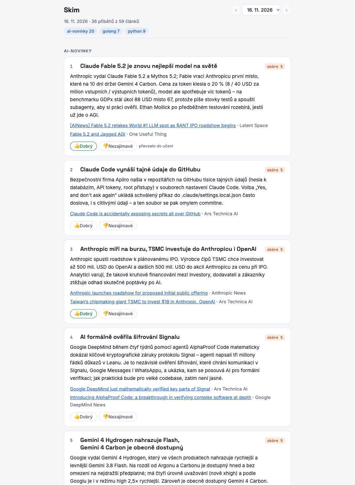
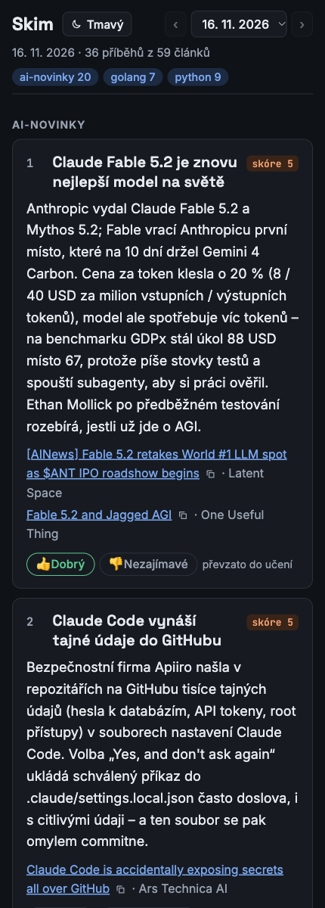

# skim

[](https://github.com/podanypepa/skim/actions/workflows/ci.yml)
[](LICENSE)

**A personal RSS agent that reads the feeds for you and hands you a short daily digest.**

skim is a replacement for scrolling through hundreds of headlines in a
feed reader. You tell it what you care about, it follows a small set of
hand-picked sources, scores every new article against your interests,
groups duplicate coverage into stories and writes a concise daily digest
with correct links back to the originals.

It is built as a set of [Claude Code](https://claude.com/claude-code)
**skills** (the judgement: what is relevant, what is one story, how to
summarise it) on top of small, deterministic **Go tools** (the mechanics:
fetching, parsing, validating, storing, rendering).

```
> skim

Fetched 151 · triaged 151 · 36 stories · 0 feeds failed

## ai-novinky
1. Claude Fable 5.2 is the top model again — 20 % cheaper per token, but hungrier …
2. Claude Code leaks secrets to GitHub — "don't ask again" stores commands verbatim …
…
## golang
21. Go turns 17: the year in review and a look at 1.28 …
…
## python
28. Tim Peters has died …
…
Feedback? e.g. "22 good, 26 not interesting".
```

---

## Why

Feed readers show you *everything* and leave the filtering to you. skim
flips that around:

- **You describe interests once** (`topics.md`) — what you want, what you
  don't, how deep, how much per day.
- **The agent does the reading** — every article gets a 1–5 score and a
  one-sentence reason, so mistakes are visible and easy to correct.
- **You read one digest a day** — stories, not headlines; the same news
  from five outlets becomes one entry with five sources.

The split between skills and Go tools is deliberate: language models are
good at judgement and bad at bookkeeping, so every step where a mistake
would be silent (duplicates, broken links, half-written files) is handled
by code with tests, and the model only ever produces content that the
code validates before anything is written.

## How it works

```
  feeds.yaml          topics.md                topics.md
      │                   │                        │
      ▼                   ▼                        ▼
┌────────────┐     ┌──────────────┐        ┌──────────────┐
│ skimfetch  │────▶│ skim-triage  │───────▶│ skim-digest  │◀── your feedback
│    (Go)    │     │ + skimtriage │        │ + skimdigest │
└─────┬──────┘     └──────┬───────┘        └──────┬───────┘
      ▼                   ▼                       ▼
data/articles/     data/triage/            data/digest/D.md
   D.jsonl            D.jsonl                (+ D.json)
```

1. **Fetch** — `skimfetch` downloads every feed in `feeds.yaml`
   concurrently, uses conditional requests (ETag / Last-Modified), parses
   RSS 2.0, RSS 1.0 and Atom, deduplicates by GUID / link, converts HTML
   to plain text and appends new articles to a daily JSONL file. A broken
   feed never stops the run.
2. **Triage** — the `skim-triage` skill reads `topics.md` and scores each
   new article 1–5 with a short reason. `skimtriage pending` hands out
   batches of untriaged articles; `skimtriage save` validates the batch
   (known ids, integer scores, reason length…) and writes it **all or
   nothing**.
3. **Full text** — many feeds only carry a teaser (or nothing). Before
   the digest, `skimdigest fulltext` fetches the article page for
   candidates with short content, extracts the readable text and stores
   it, so summaries have real substance. It honours robots.txt (RFC 9309,
   including every redirect hop), only connects to public addresses, and
   tries each page once — transient failures (network, 429, 5xx) are
   retried on the next run. Sites that block bots (e.g. Reddit) keep their
   feed excerpt.
4. **Digest** — the `skim-digest` skill groups the best candidates into
   stories and writes the summaries. `skimdigest render` validates the
   structure and renders the markdown from a fixed template. **Links,
   feed names and article titles always come from the archive, never from
   the model**, so they cannot be hallucinated or mistyped.
5. **Feedback & learning** — tell it in chat which stories were good or
   bad; `skimdigest feedback` maps story numbers back to article ids.
   Triage reads your recent votes as examples (`skimtriage examples`,
   disagreements first), and about once a week (`skimtriage report`)
   `skim` proposes concrete edits to `topics.md`, backed by vote counts —
   applied only if you agree. `topics.md` always wins over examples.

The `skim` skill runs all of this in one go.

### Scoring scale

| Score | Meaning |
|------:|---------|
| 5 | Must see — a major development in one of your topics |
| 4 | Worth reading — relevant and substantive |
| 3 | Maybe — on topic but marginal (kept as "more news") |
| 2 | Probably not — weak link, mostly PR |
| 1 | Noise — off topic, clickbait, or explicitly unwanted |

The digest takes stories scored ≥ 4, up to each topic's daily volume, and
a handful of 3s as a "more news" list.

## Getting started

### Requirements

- **The `skim` binary** from Releases, **or Go 1.24+** (standard library
  only — no third-party dependencies)
- **[Claude Code](https://claude.com/claude-code)** for the skills
  (the Go tools also work on their own)

### Install

```sh
git clone https://github.com/podanypepa/skim.git
cd skim
```

The skills run the tools through `./skim`: with Go installed it runs the
code in the repo (`go run ./cmd/skim`, always in sync after `git pull`),
otherwise it uses a `skim` binary from your `PATH`. Pick one:

- **No Go needed:** download the archive for your system from
  [Releases](https://github.com/podanypepa/skim/releases) (macOS Intel /
  Apple Silicon, Linux, Windows), check it against `SHA256SUMS` and put the
  `skim` binary on your `PATH`. Update it after a `git pull` that brings a
  new release. On macOS the binary is unsigned: if it is blocked, run
  `xattr -d com.apple.quarantine skim`.
- **With Go 1.24+:** `go install github.com/podanypepa/skim/cmd/skim@latest`.
- **Or nothing:** with Go installed, `./skim` just works from the repo.

Check with `./skim version`.

The skills live in `skills/` and are exposed to Claude Code through the
`.claude/skills` symlink, so opening the repository in Claude Code is
enough.

### Configure

The repository ships with the author's own topics and feeds as a working
example. Make them yours:

1. **Topics** — edit `topics.md`, or ask Claude to add a topic:
   > *add a topic about Rust*

   Each topic has a description, what you want, what you don't, the depth
   you prefer, languages and a rough daily volume.
2. **Sources** — run the `skim-discover` skill for a topic:
   > *find sources for rust*

   It searches from several angles, verifies every candidate with
   `feedcheck`, shows a table (core / optional / high volume) with posting
   frequency and why each one is worth it, and adds only what you approve.

### Daily use

```
> skim
```

That's it. It fetches, triages, builds today's digest (or refreshes it if
something new and important arrived), publishes the digest page and shows
a short version in chat. The full digest is also saved to
`data/digest/YYYY-MM-DD.md`.

### The digest page

`skim` keeps one private page on claude.ai (an artifact) with a stable
link: the latest digest on top, the last 14 days a tap away, topics as
sections and 👍/👎 on every story. It reads well on a phone, in light and
dark mode. The template is `web/digest.html`; `skimdigest export` writes
its data file. Votes are stored in the page's own database and imported
into `data/feedback.jsonl` on the next `skim` run, where triage learns
from them.

#### Reading it on your phone

The page is a private claude.ai artifact, so it opens wherever you are
signed in to the same Claude account — including the Claude mobile app.

1. Run `skim` once on your computer — it publishes the page and prints its
   link (also saved in `data/web/artifact-url`). The link never changes;
   every run updates the same page.
2. **Get it into the Claude app (easiest):** in Claude Code, ask Claude to
   *pin the digest page*. Pinned artifacts appear in the claude.ai sidebar,
   which the Claude app on your phone shares — open the sidebar there and
   tap **Skim**. Nothing to copy between devices.
3. Or send yourself the link (notes, messages, mail) and open it on the
   phone in the Claude app or a mobile browser signed in to the same
   account. Without signing in it won't open — the page is private unless
   you share it from its Share menu.
4. For one-tap access from the home screen, open the link in Safari or
   Chrome and choose **Share → Add to Home Screen**.

Votes you give on the phone are imported the next time `skim` runs on
your computer.

<p align="center">
  
  &nbsp;
  
</p>

Give feedback in plain words:

```
> 22 good, 26 not interesting
```

## Skills

| Skill | What it does |
|-------|--------------|
| `skim` | **Daily entry point**: fetch → triage → digest, shown in chat |
| `skim-discover` | Finds, verifies and proposes feeds for a topic; adds approved ones to `feeds.yaml` |
| `skim-topics` | Lists topics with feed counts; adds, renames, merges or deletes topics (keeps `topics.md` and `feeds.yaml` in sync) |
| `skim-fetch` | Fetches new articles and reports what arrived and which feeds are failing |
| `skim-triage` | Scores new articles 1–5 against `topics.md` with a one-sentence reason |
| `skim-digest` | Builds the daily digest and records feedback |

Skills never add feeds or change your topics without asking.

## Tools

One binary, `skim`, with subcommands. All of them print JSONL so they are
easy for both humans and agents to read. The older per-tool commands
(`go run ./cmd/skimfetch` …) still work.

```sh
# Check feeds (or find the feed of a website)
./skim check https://go.dev/blog https://simonwillison.net

# Fetch new articles (all feeds, one topic, or a dry run)
./skim fetch [-topic golang] [-dry-run] [-backfill-days 7]

# Triage bookkeeping and feedback learning
./skim triage pending [-limit 25] [-days 7] [-topic slug]
./skim triage save < scores.jsonl
./skim triage examples [-n 30]
./skim triage report [-mark]

# Digest
./skim digest export     [-days 14]   # data for the digest page
./skim digest fulltext   [-day …] [-min 3] [-short 600]
./skim digest candidates [-day 2026-11-16] [-min 3]
./skim digest render     [-day …] [-force] < digest.json
./skim digest feedback    -day …           < feedback.jsonl
```

## Data

Everything lives in plain files under `data/` (git-ignored):

| Path | Contents |
|------|----------|
| `data/articles/YYYY-MM-DD.jsonl` | Articles by fetch day — id, feed, topic, title, url, published, plain-text content |
| `data/state.json` | Per-feed fetch state: ETag, Last-Modified, failures, seen ids |
| `data/triage/YYYY-MM-DD.jsonl` | Scores and reasons, same day as the article file |
| `data/digest/YYYY-MM-DD.md` / `.json` | The rendered digest and its structured form |
| `data/fulltext/YYYY-MM-DD.jsonl` | Article text fetched from the web for digest candidates |
| `data/feedback.jsonl` | Your votes on digest stories |
| `data/proposals.jsonl` | When `topics.md` edits were last proposed |
| `data/web/` | Digest page data (`digests.json`) and the page's URL |

Article and triage files are **append-only**; nothing is ever rewritten.
Plain JSONL means you can `grep`, `jq` or open everything in an editor.

## Design principles

- **Judgement in skills, mechanics in Go.** The model never does
  bookkeeping; the code never guesses.
- **Standard library only.** Including a tiny parser for the `feeds.yaml`
  schema instead of a YAML dependency.
- **All or nothing.** Every write of model-produced data is validated
  first; one bad line rejects the whole batch with every problem listed.
- **Append-only archive, atomic state.** A crash can at worst cause a
  duplicate, never lost or corrupted data.
- **Links from the archive.** The digest renderer escapes titles and
  rejects links or markdown structure in model-written text.
- **Your approval for changes.** Feeds and topics change only when you
  say so.

## Project layout

```
cmd/skim/        the skim binary (check, fetch, triage, digest)
cmd/feedcheck|skimfetch|skimtriage|skimdigest/  compatibility wrappers
internal/
  app/           tool logic: check, fetch, triage, digest
  feed/          RSS / RDF / Atom parser, HTML → text
  feedsfile/     feeds.yaml reader
  store/         archive, state, triage and feedback storage
skills/          Claude Code skills (symlinked as .claude/skills)
web/             digest page template (published as a claude.ai artifact)
docs/superpowers/ design specs and implementation plans
topics.md        your interests — source of truth for discovery and triage
feeds.yaml       subscribed feeds
```

## Development

```sh
gofmt -l .          # must print nothing
go vet ./...
go test ./...
```

Each component was designed first (`docs/superpowers/specs/`), planned
(`docs/superpowers/plans/`), built test-first and reviewed. The project
conventions for agents are in `CLAUDE.md`.

## Status

Working and used daily by the author. Possible next steps:

- scheduled runs.

The project documentation for agents (`CLAUDE.md`, skills) is written in
Czech — the author's language — while code and this README are in English.

## License

[MIT](LICENSE) © 2026 Josef Podany
